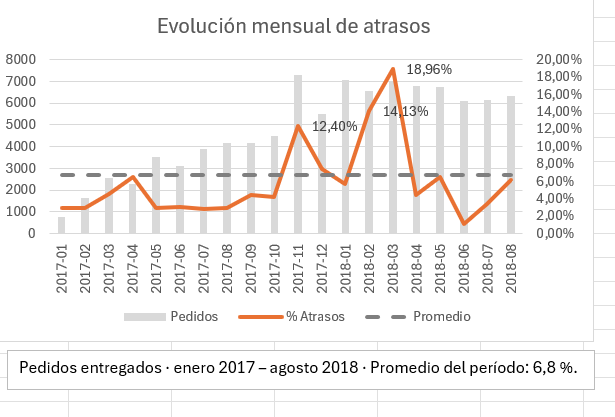
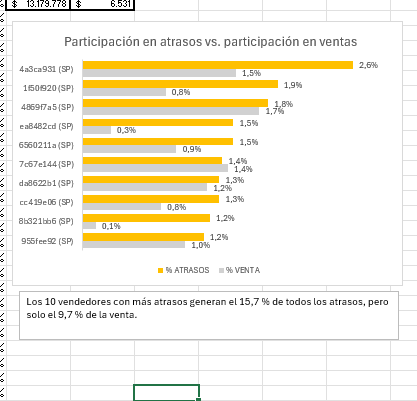
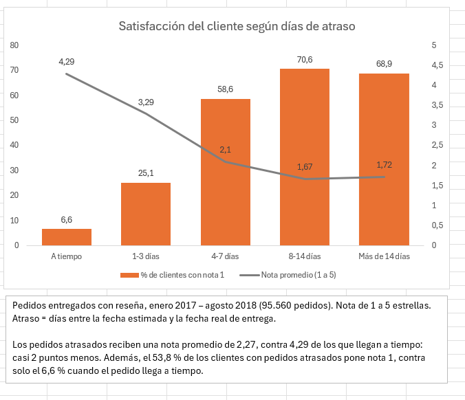

# Análisis e-commerce Olist: entregas, vendedores y satisfacción del cliente

**Cuando un pedido llega tarde, más de la mitad de los clientes pone la peor nota posible.** Este proyecto mide cuánto se atrasan los pedidos, qué vendedores concentran esos atrasos y cuánto le cuesta el atraso a la empresa en satisfacción del cliente.

**Herramientas:** SQL (SQLite · DB Browser) · Excel
**Datos:** [Brazilian E-Commerce Public Dataset by Olist](https://www.kaggle.com/datasets/olistbr/brazilian-ecommerce): pedidos reales y anonimizados de un marketplace de Brasil. 9 tablas, ~100.000 pedidos, septiembre 2016 a octubre 2018. Montos en reales (R$).

---

## 1. El problema de negocio

Un gerente de operaciones necesita decidir **a qué vendedores exigirles mejoras en sus entregas** y **cuánto importa realmente el atraso** para el negocio. Para eso, el análisis responde 3 preguntas:

| # | Pregunta | Para quién |
| --- | --- | --- |
| 1 | ¿Qué porcentaje de pedidos llega tarde, y cómo evoluciona mes a mes? | Operaciones |
| 2 | ¿Qué vendedores concentran los atrasos, y cuánta venta representan? | Comercial |
| 3 | ¿Cuánto baja la nota de la reseña cuando un pedido llega tarde? | Experiencia del cliente |

**Definición usada:** un pedido está **atrasado** si la fecha real de entrega es posterior a la fecha estimada que se le prometió al cliente, comparando solo la fecha, sin la hora.

---

## 2. El enfoque

### Exploración y calidad de datos

Antes de analizar, revisé la calidad de las 9 tablas con una [plantilla SQL de perfilamiento](00_plantilla_calidad_olist.sql): conteo de filas, vacíos, duplicados, formatos, cruces entre tablas, fechas y montos. Registré **27 hallazgos** en una [bitácora de calidad](bitacora_calidad_olist.xlsx), cada uno con su impacto en las preguntas de negocio y la decisión tomada.

Los más relevantes:

- **Algunos pedidos tienen más de una reseña.** Sin corregirlo, el JOIN duplicaría pedidos e inflaría los promedios.
- **2.965 pedidos sin fecha de entrega**, en su mayoría no entregados (cancelados, en tránsito, etc.).
- **Los extremos del período están incompletos** (meses con 1 a 300 pedidos), y distorsionarían la tendencia.

### Capa de datos limpia

Creé [3 vistas SQL](01_vistas_limpias.sql) sin modificar las tablas originales:

| Vista | Qué contiene | Filas |
| --- | --- | --- |
| `pedidos_limpios` | Pedidos entregados, con fecha de entrega, de enero 2017 a agosto 2018 | 96.203 |
| `resenas_por_pedido` | Una reseña por pedido, la más reciente (con `ROW_NUMBER()`) | 98.673 |
| `lineas_pedido` | Cada producto vendido, con su vendedor y precio | 112.650 |

**Conciliación:** 96.478 pedidos entregados − 8 sin fecha de entrega − 267 fuera del período = **96.203 pedidos analizados**.

---

## 3. Hallazgos

### Hallazgo 1 · El atraso no es parejo: se dispara en meses puntuales



- El **6,8 %** de los pedidos llega tarde (6.531 de 96.203).
- El atraso se dispara en **noviembre 2017 (12,4 %)** y en **febrero y marzo 2018 (14,1 % y 19,0 %)**, hasta casi el triple del promedio.
- Después de abril 2018 vuelve a moverse **entre 1 % y 7 %**.
- El problema no es que haya más atrasos porque hay más pedidos: son **meses puntuales en que la operación falló**.

[Consulta SQL](02_pregunta_1_atraso_mensual.sql)

### Hallazgo 2 · Pocos vendedores concentran una parte desproporcionada de los atrasos



Clasifiqué a los vendedores con al menos 50 pedidos según su volumen (más o menos de 200 pedidos) y su atraso (sobre o bajo el promedio de 6,8 %):

| Segmento | Criterio | Vendedores |
| --- | --- | --- |
| **Prioridad** | ≥ 200 pedidos y atraso > 6,8 % | **39** |
| Vigilar | < 200 pedidos y atraso > 6,8 % | Resto con atraso alto |
| Clave | ≥ 200 pedidos y atraso ≤ 6,8 % | 46 |
| Confiable | < 200 pedidos y atraso ≤ 6,8 % | Resto con atraso bajo |

- Los **39 vendedores prioritarios** acumulan el **28 % de todos los atrasos** (1.840 de 6.531) y **R$233.000 en venta atrasada**.
- Los **10 vendedores con más atrasos** generan el **15,7 % de los atrasos**, pero solo el **9,7 % de la venta**.
- Hay vendedores muy desproporcionados: uno genera el **1,2 % de los atrasos con solo el 0,1 % de la venta** (casi 10 veces más de lo que le correspondería por su tamaño), y otro el 1,5 % con el 0,3 %.

[Consulta SQL](03_pregunta_2_vendedores.sql)

### Hallazgo 3 · El atraso hunde la satisfacción del cliente, y el daño ocurre en la primera semana



| | A tiempo | Atrasado |
| --- | --- | --- |
| Nota promedio (1 a 5) | **4,29** | **2,27** |
| % de clientes con nota 1 | 6,6 % | **53,8 %** |
| % de clientes con nota 5 | 62,3 % | 16,5 % |

- Un pedido atrasado recibe **casi 2 puntos menos** de nota, y la proporción de clientes con nota 1 se multiplica por 8.
- **Con solo 1 a 3 días de atraso**, la nota ya cae a 3,29.
- **Con 4 a 7 días de atraso**, más de la mitad de los clientes (58,6 %) pone nota 1, y desde ahí no baja de ese nivel.
- **Sobre los 8 días**, la nota toca fondo, cerca de 1,7. Después de la primera semana ya no puede empeorar mucho más.

[Consulta SQL](04_pregunta_3_resenas.sql)

---

## 4. Recomendaciones

1. **Plan de mejora con los 39 vendedores prioritarios**, empezando por los que generan más atrasos de lo que pesan en ventas. Atacar ese grupo actúa sobre el 28 % de los atrasos.
2. **Alerta temprana antes del día 4 de atraso.** Avisar al cliente o priorizar los pedidos que están por atrasarse, porque en esa ventana todavía se puede salvar la nota.
3. **Investigar qué pasó en noviembre 2017 y en febrero-marzo 2018.** Una hipótesis a validar es la falta de capacidad logística en períodos de alta demanda (como el Black Friday), pero los datos disponibles no permiten confirmarla.

---

## 5. Limitaciones

- **643 de los 96.203 pedidos analizados no tienen reseña** y quedan fuera de la pregunta 3.
- Un pedido con productos de varios vendedores cuenta como atrasado para cada uno; el efecto en los porcentajes por vendedor es menor.
- La venta considera el precio de los productos, sin flete.
- El análisis muestra una **relación** entre atraso y nota, no prueba que el atraso sea la única causa de la baja nota.
- La **fecha estimada** la define Olist. Si fue poco realista, parte del "atraso" puede ser una mala promesa y no una mala entrega.
- Los datos no explican **por qué** se produjeron los peaks de atraso.

---

## 6. Estructura del repositorio

```
proyecto_olist/
├── README.md                          ← este informe
├── bitacora_calidad_olist.xlsx        ← 27 hallazgos de calidad y decisiones
├── sql/
│   ├── 00_plantilla_calidad_olist.sql ← perfilamiento de calidad de datos
│   ├── 01_vistas_limpias.sql          ← capa limpia (3 vistas)
│   ├── 02_pregunta_1_atraso_mensual.sql
│   ├── 03_pregunta_2_vendedores.sql
│   └── 04_pregunta_3_resenas.sql
└── img/                               ← gráficos del informe
```

---

**Autor:** Javier Briceño · [LinkedIn](https://www.linkedin.com/in/javier-brice%C3%B1o-59b218334/) · [GitHub](https://github.com/javierbricenojimenez-lgtm)
